<div align="center">

# My Shell

**A minimal settings window and status bar for Hyprland, built with [Quickshell](https://quickshell.org).**

Colors follow pywal live · 10 pages · 7 bar layouts · no extra daemons


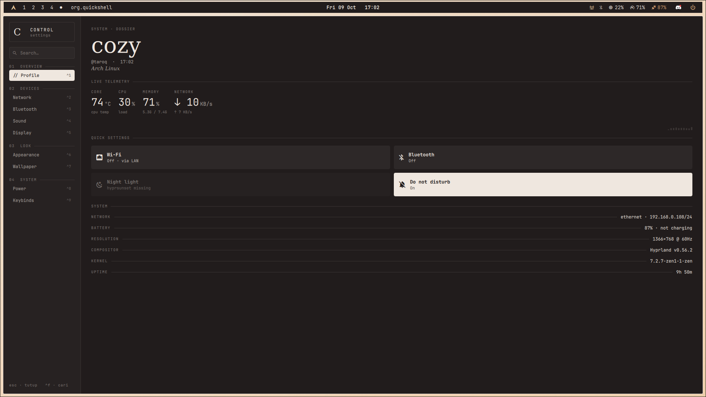

</div>

---

## What is this

My personal desktop shell for Hyprland. It started as a small control center and grew into two things that live in the same Quickshell config:

- **Control Center**, a regular app window (not a panel) with a sidebar and pages for network, sound, display, wallpaper, clipboard and so on.
- **Bar**, a status bar that replaces Waybar. It ships with seven layouts ported from my old Waybar setup, and you can switch between them without restarting anything.

Everything reads its colors from pywal, so when the wallpaper changes, the whole shell changes with it.

---

## Preview

<table>
  <tr>
    <td width="50%">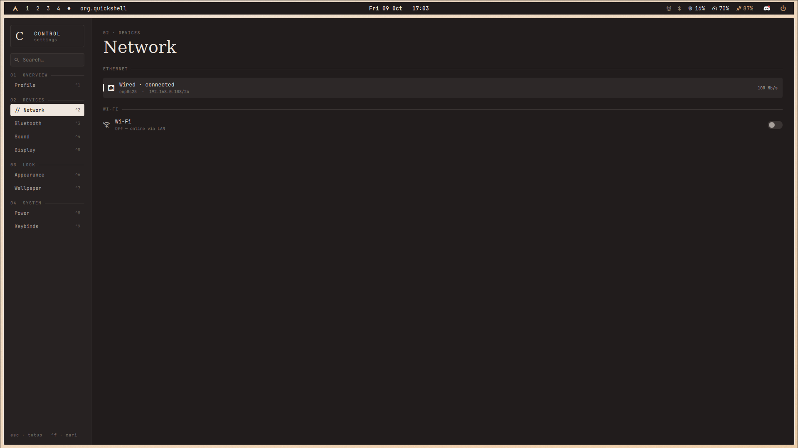<br><sub><b>Network</b> — Ethernet, Wi-Fi, scan and connect</sub></td>
    <td width="50%">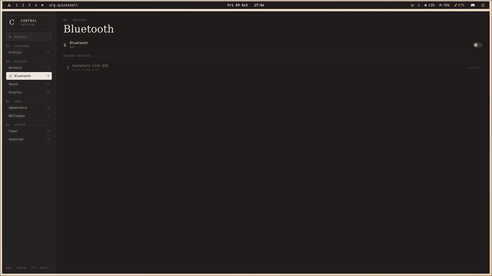<br><sub><b>Bluetooth</b> — paired devices</sub></td>
  </tr>
  <tr>
    <td>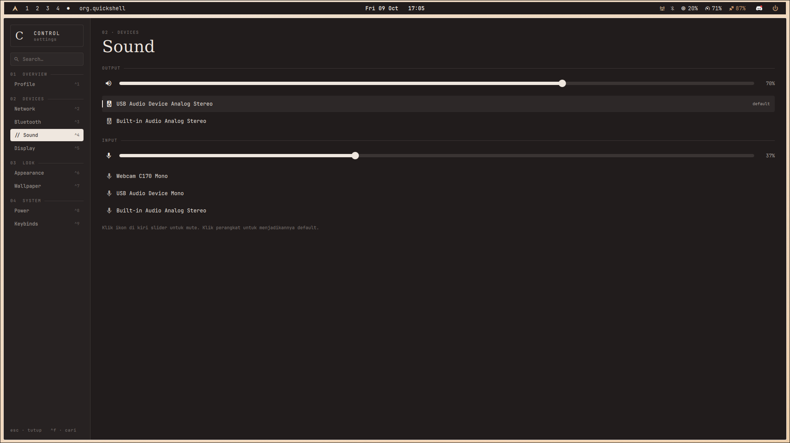<br><sub><b>Sound</b> — volume, mic, output and input</sub></td>
    <td>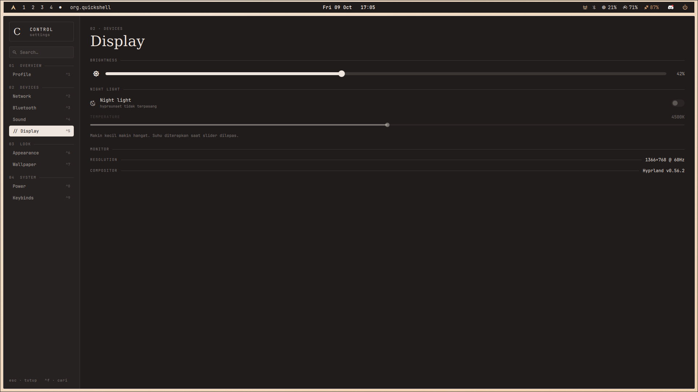<br><sub><b>Display</b> — brightness and night light</sub></td>
  </tr>
  <tr>
    <td>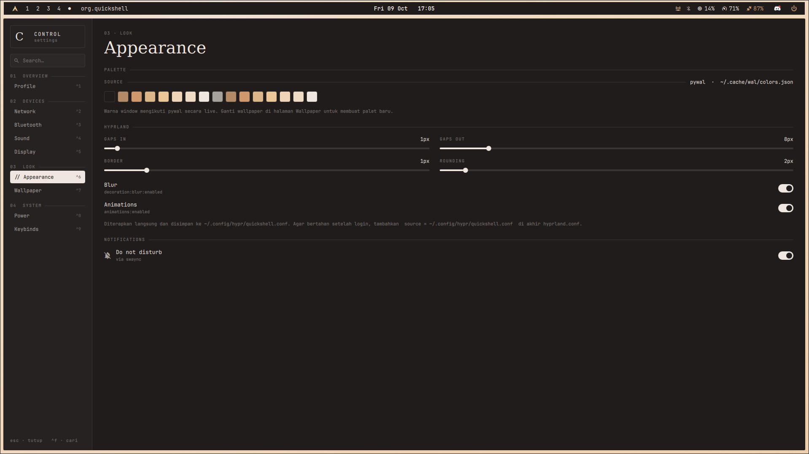<br><sub><b>Appearance</b> — pywal palette, bar layouts, Hyprland options</sub></td>
    <td>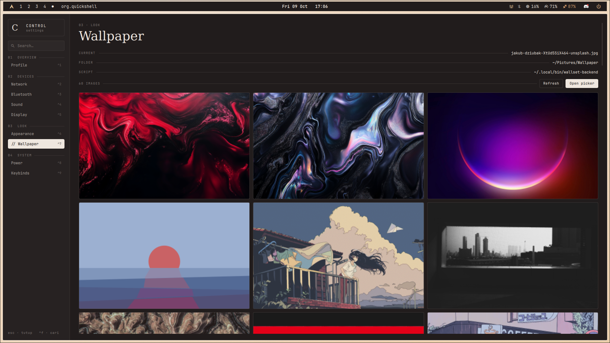<br><sub><b>Wallpaper</b> — thumbnail grid</sub></td>
  </tr>
  <tr>
    <td>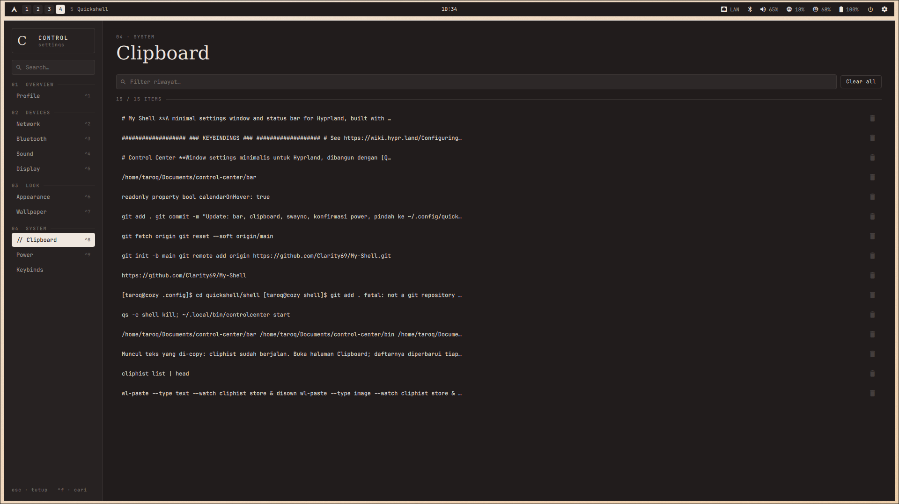<br><sub><b>Clipboard</b> — text and image history</sub></td>
    <td>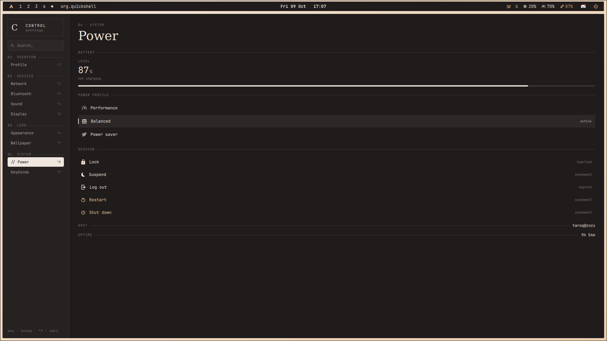<br><sub><b>Power</b> — battery, power profile, session</sub></td>
  </tr>
  <tr>
    <td>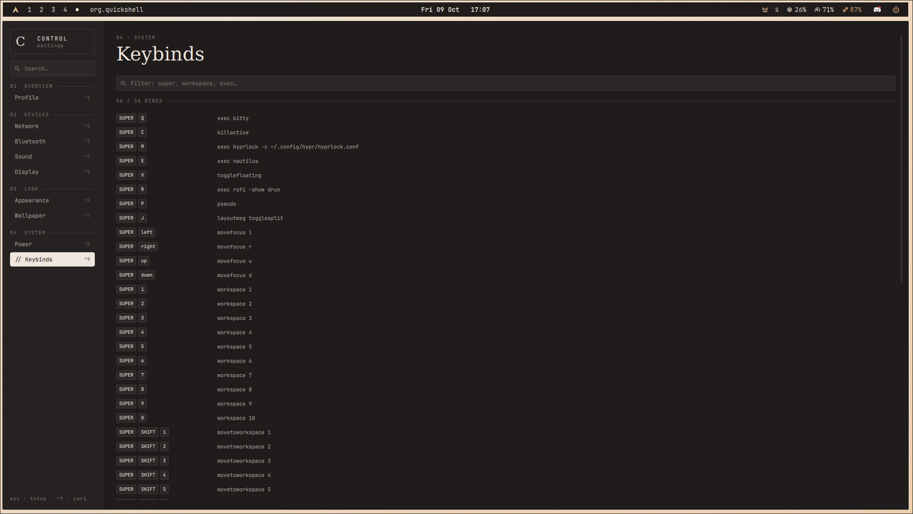<br><sub><b>Keybinds</b> — every active bind, filterable</sub></td>
    <td>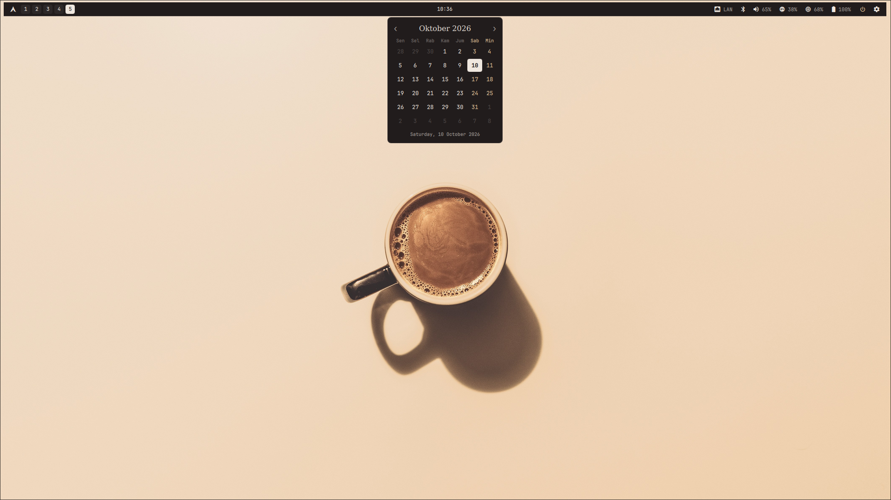<br><sub><b>Bar calendar</b> — hover or right-click the clock</sub></td>
  </tr>
</table>

<details>
<summary><b>Bar layouts</b></summary>
<br>
<tr>
  <p>Omarchy style bar
  <td>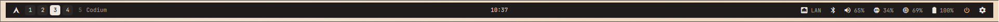<br></td>
</tr>
<tr>
  <p>Cozy style bar
 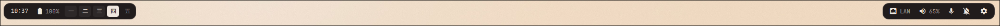<br>
</tr>
<tr>
  <p>Everforest style bar
<br>
</tr>

</details>

---

## Features

### Control Center

| Page | What it does | Backend |
|---|---|---|
| **Profile** | hostname, live telemetry (temp, CPU, RAM, network), quick toggles, system info | `/proc`, `/sys` |
| **Network** | Ethernet status (IP, link speed), Wi-Fi on/off, scan, connect and disconnect | `nmcli` |
| **Bluetooth** | power, paired devices, connect and disconnect | `bluetoothctl` |
| **Sound** | volume and mic, pick default output and input | `wpctl` |
| **Display** | brightness, night light with color temperature, monitor info | `brightnessctl`, `hyprsunset` |
| **Appearance** | pywal palette, bar layout picker, gaps / border / rounding / blur / animations, notifications | `hyprctl`, `swaync` |
| **Wallpaper** | thumbnail grid that calls your own wallpaper script, plus a button for your picker | `wallset-backend`, `hyprquickpaper` |
| **Clipboard** | text and image history with thumbnails, filter, copy again, delete | `cliphist`, `wl-clipboard` |
| **Power** | battery, power profile, lock / suspend / log out / restart / shut down | `upower`, `powerprofilesctl` |
| **Keybinds** | every active Hyprland bind, filterable | `hyprctl binds` |

Log out, Restart and Shut down need a second click within 5 seconds, so a stray click won't take the machine down.

### Bar

- One bar per monitor, with workspaces (numbers, kanji or roman numerals), active app, clock, tray, network, bluetooth, volume, mic, brightness, battery, CPU, memory, power profile, notifications and clipboard.
- Seven layouts: `omarchy`, `minimal`, `full`, `cozy`, `everforest`, `border-only`, `hyprnova`. Three styles: a solid bar, separate "islands", or bordered modules only.
- Every indicator opens the matching Control Center page on click. Volume, mic and brightness react to scroll.
- The clock shows a small calendar on hover or right-click.
- The notification bell shows the swaync count live. Left click opens the swaync panel, right click toggles Do Not Disturb, middle click clears everything.
- The last picked layout is remembered across logins.

### Shortcuts inside the window

| Key | Action |
|---|---|
| `Ctrl` + `1`…`9` | jump to a page |
| `Ctrl` + `F` | search settings |
| `Esc` | clear search, or close the window |

---

## Layout

```
shell/
├── shell.qml               entry point: ShellRoot, Bar, IPC handlers
├── ControlCenter.qml       the window: page list, sidebar, StackLayout
├── config/
│   ├── Config.qml          your paths and commands (wallpaper, picker, clipboard, bar)
│   ├── Theme.qml           pywal colors, sizes, fonts
│   └── Icons.qml           Nerd Font glyphs
├── components/             pure UI, never runs commands
├── pages/                  one file per Control Center page
├── services/               one singleton per data source or CLI tool
├── bar/
│   ├── BarState.qml        layout definitions and the active layout
│   ├── Module.qml          every bar module and its click actions
│   └── ...                 Workspaces, Tray, ClockItem, CalendarPopup
├── bin/
│   ├── controlcenter       launcher: toggle / open / start
│   └── bar-layout          rofi picker for bar layouts
├── screenshots/
├── hyprland.conf.snippet
└── waybar.snippet          only if you keep Waybar instead of the built-in bar
```

The rule I try to keep: `components/` never runs a shell command and `services/` never draws anything. Polling only runs for the page that is actually open.

---

## Dependencies

**Required:** `quickshell` (0.2 or newer), `networkmanager`, `bluez` and `bluez-utils`, `wireplumber`, a Nerd Font (defaults to `JetBrainsMono Nerd Font`).

**Optional.** Anything missing just hides or disables its feature: `brightnessctl`, `hyprsunset`, `awww`, `python-pywal`, `cliphist`, `wl-clipboard`, `upower`, `power-profiles-daemon`, `swaync` (or `mako` / `dunst` for DND only), `hyprlock`, `rofi`, `noto-fonts-cjk` for the kanji workspaces.

```sh
sudo pacman -S --needed quickshell networkmanager bluez bluez-utils wireplumber \
    brightnessctl hyprsunset upower power-profiles-daemon cliphist wl-clipboard \
    ttf-jetbrains-mono-nerd noto-fonts-cjk
```

---

## Install

```sh
git clone https://github.com/Clarity69/My-Shell.git ~/.config/quickshell/shell

ln -sf ~/.config/quickshell/shell/bin/controlcenter ~/.local/bin/controlcenter
ln -sf ~/.config/quickshell/shell/bin/bar-layout    ~/.local/bin/bar-layout
chmod +x ~/.config/quickshell/shell/bin/*

controlcenter start      # bar shows up, the window stays hidden
controlcenter            # open the window
```

While hacking on it, run it in the foreground so errors show up in the terminal:

```sh
qs -c shell kill; qs -c shell
```

Then open `config/Config.qml` and point the paths at your own setup. The defaults are mine.

### Hyprland

Add this to `~/.config/hypr/hyprland.conf` and remove `exec-once = waybar` if you're switching over. The full version is in `hyprland.conf.snippet`.

```ini
exec-once = ~/.local/bin/controlcenter start
exec-once = wl-paste --type text  --watch cliphist store
exec-once = wl-paste --type image --watch cliphist store

windowrule = float, title:^(Control Center)$
windowrule = center, title:^(Control Center)$
windowrule = pin, title:^(Control Center)$

# keep this last, it stores what the Appearance page changes
source = ~/.config/hypr/quickshell.conf
```

Create the overrides file once so Hyprland doesn't complain before you've touched anything:

```sh
touch ~/.config/hypr/quickshell.conf
```

### Keybinds I use

```ini
bind = $mainMod, A, exec, ~/.local/bin/controlcenter                  # toggle the window
bind = $mainMod, V, exec, ~/.local/bin/controlcenter open clipboard   # clipboard history
bind = $mainMod, K, exec, quickshell -c hyprquickpaper                # wallpaper picker
bind = $mainMod ALT, B, exec, ~/.local/bin/bar-layout                 # pick a bar layout
bind = $mainMod ALT, N, exec, ~/.local/bin/bar-layout next            # next bar layout
```

---

## Launcher

`bin/controlcenter` is what Hyprland and the bar call. It starts Quickshell if it isn't running, and it asks Hyprland what's actually on screen before toggling, so one press always does the expected thing even if the window is on another workspace.

```sh
controlcenter              # toggle
controlcenter open sound   # open a specific page
controlcenter start        # start in the background (for exec-once)
```

Every call is logged to `~/.cache/controlcenter.log`.

---

## Bar layouts

Switch from the Appearance page, from rofi, or from a terminal:

```sh
bar-layout            # rofi menu
bar-layout cozy       # jump straight to one
bar-layout next       # cycle
```

Layouts live in `bar/BarState.qml`. Adding one is a single entry:

```qml
"my-layout": {
    style: "islands", height: 30, radius: 10, margin: { top: 6, left: 10, right: 10 },
    left:   ["workspaces:kanji", "window:app"],
    center: ["datetime"],
    right:  ["tray", "notification", "volume", "battery", "control"]
},
```

Available modules: `workspaces` (`:kanji`, `:roman`), `window` (`:app` for the app name only), `clock`, `date`, `datetime`, `launcher`, `network`, `bluetooth`, `volume`, `mic`, `brightness`, `battery`, `cpu`, `memory`, `profile`, `notification`, `clipboard`, `tray`, `power`, `control`.

Click actions for each module are in `bar/Module.qml`. Every module has `onClicked`, `onRightClicked`, `onMiddleClicked` and `onScrolled`, so changing what a click does is a one-line edit.

---

## IPC

```sh
qs -c shell ipc call controlcenter toggle
qs -c shell ipc call controlcenter open <page>
qs -c shell ipc call bar toggle
qs -c shell ipc call bar layout <name>
qs -c shell ipc call bar next
```

Pages: `profile` `network` `bluetooth` `sound` `display` `appearance` `wallpaper` `clipboard` `power` `keybinds`

---

## Config

Paths and external commands are all in `config/Config.qml`:

| Option | Default | Notes |
|---|---|---|
| `walColors` | `~/.cache/wal/colors.json` | watched by Theme, colors update when pywal rewrites it |
| `wallpaperDir` | `~/Pictures/Wallpaper` | folder shown in the Wallpaper page |
| `wallpaperSet` | `~/.local/bin/wallset-backend "$1"` | runs when a thumbnail is clicked, `$1` is the image path |
| `wallpaperPicker` | `quickshell -c hyprquickpaper` | opened by the *Open picker* button |
| `wallpaperLog` | `~/.cache/wallset-backend.log` | backend output goes here |
| `clipLimit` | `80` | how many clipboard entries to show |
| `hyprOverrides` | `~/.config/hypr/quickshell.conf` | written by the Appearance page |
| `nightLightDefault` | `4500` | starting night light temperature in K |
| `barEnabled` | `true` | show the bar on start |
| `barLayout` | `omarchy` | layout used until you pick one |
| `calendarOnHover` | `true` | set to `false` to open the calendar on right-click only |
| `launcherCommand` | `rofi -show drun` | what the launcher module runs |

Colors, window size and fonts are in `config/Theme.qml`.

---

## Taking screenshots

The images above are read from `screenshots/`. Open a page, focus the window, then:

```sh
cd ~/.config/quickshell/shell/screenshots
controlcenter open network
sleep 2 && grim -g "$(hyprctl activewindow -j | jq -r '"\(.at[0]),\(.at[1]) \(.size[0])x\(.size[1])"')" Network.png
```

`hyprshot -m window -o . -f Network.png` works too.

---

## Notes

- Your wallpaper script should not restart Waybar anymore if you use the built-in bar. The bar picks up pywal colors on its own.
- swaync doesn't expose notification contents through `swaync-client`, so the shell shows the count and controls, and the contents stay in the swaync panel.
- mako needs a DND mode in its config: `[mode=do-not-disturb]` with `invisible=1`.
- Saved Wi-Fi networks are matched by the SSID stored in NetworkManager. New locked networks ask for a password right in the list.
- The Appearance page applies changes with `hyprctl keyword`. They only stick across logins if `quickshell.conf` is sourced at the end of `hyprland.conf`.
- Hyprland 0.55 added Lua configs. `hyprland.conf` still works, but if you move to `hyprland.lua` the Appearance page will need `hyprctl eval` instead of `keyword`.